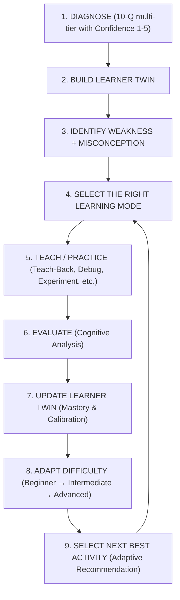

# AI Learning Twin 🧠✨

> **"Most AI tutors adapt the answer. AI Learning Twin adapts the learning experience."**
> 
> *An adaptive AI tutor that builds a live model of how each learner understands, answers, explains, and improves.*

[](https://react.dev/)
[](https://aistudio.google.com/)
[](https://tailwindcss.com/)
[](https://www.typescriptlang.org/)
[](https://vercel.com/)

---

## 🚀 The Product Identity & Difference

Conventional AI tutors and chatbots treat learning as a simple Q&A lookup: you ask a question, the AI generates a reply, and testing consists of generic multiple-choice questions.

**AI Learning Twin is fundamentally different:**
It constructs and continuously updates a **living Digital Twin of the learner**:
- **Probabilistic Mastery by Concept:** Tracks Python, Data Handling, ML Fundamentals, and Model Evaluation.
- **Deep Cognitive Misconception Detection:** Uncovers *why* an answer or explanation is flawed (e.g. confusing 100% training accuracy with good generalization).
- **Confidence vs. Knowledge Calibration:** Detects overconfidence (high certainty on memorized training scores despite poor validation generalization) and underconfidence.
- **Adaptive Difficulty:** Automatically tunes complexity (`Beginner` &rarr; `Intermediate` &rarr; `Advanced`).
- **Dynamic Learning Trajectory:** Reroutes to the optimal activity type based on performance.

---

## 🔄 Core Closed-Loop Architecture

The application is built around this 9-stage loop:



---

## 🎯 Subject-Specific Interaction Modes

To ensure authentic mastery, each topic uses an interaction model designed specifically for that discipline:

| Topic | Learning Mode | Interactive Experience |
| :--- | :--- | :--- |
| **Python** | **Debug Mode** | Give the learner a short Python script containing subtle memory or parameter bugs (e.g. mutable default argument cache leakage). Evaluate their debugging approach and reasoning flaw. |
| **Data Handling** | **Data Cleaning Mode** | Present an interactive raw dataset containing missing values, duplicates, casing discrepancies, and impossible outliers (e.g. Age: 380). Evaluate the learner's decisions and data consequences. |
| **ML Fundamentals** | **Experiment Mode** | Live educational bias-variance simulator. Learner tunes Dataset Size, Regularization ($L_2$ Penalty), and Model Complexity to observe real-time simulated changes in Training Accuracy, Validation Accuracy, and Generalization Gap. |
| **Model Evaluation** | **Reasoning Mode** | High-stakes oncology cancer screening triage scenario. The learner selects the primary metric (*Recall*) and defends **Why?** in writing to evaluate reasoning and eliminate the Accuracy Paradox. |

---

## 🗣️ Differentiating Feature: Teach-Back Mode

Instead of the AI merely lecturing the student:
> **The student explains the concept in their own words to the AI.**

1. The learner explains what *overfitting* is and why 100% training accuracy can be dangerous.
2. The learner rates their confidence (1 to 5).
3. The cognitive engine evaluates:
   - **Conceptual Correctness**
   - **Misconception Detection** *(e.g., "MISCONCEPTION DETECTED: You reversed the training-data behavior")*
   - **Targeted Cognitive Correction**
   - **Missing Dimensions**
   - **Follow-up verification check**
4. The Learner Twin updates immediately with elevated mastery!

---

## ⚡ The Benchmark Demo Flow

Experience the entire end-to-end evaluation:

1. **Landing Page:** Click **"Start Adaptive Diagnostic"** (or use **"Demo Twin"** in the top bar).
2. **Goal Selection:** Select **Machine Learning Fundamentals** and **Python**.
3. **Diagnostic Assessment:** Click **"Fast-Fill Benchmark"** (rates confidence and selects benchmark answers). Click **"Submit & Formulate Learning Twin"**.
4. **Learning Twin Dashboard:** Observe the live cognitive model:
   - Python: **80%**
   - Data Handling: **60%**
   - ML Fundamentals: **40%** *(Weakest Area)*
   - Model Evaluation: **50%**
   - Detected Misconception: *Confusing overfitting with underfitting*
   - Confidence vs. Knowledge: *Overconfidence signal detected*
   - Recommended Next Activity: **Teach-Back Mode**
5. **Teach-Back Mode:** Click **"Start Teach-Back Mode"**. Click **"Test Misconception Flaw"** and submit to observe the AI detect the reversed training data behavior, provide the targeted correction, and check with a follow-up question.
6. **Adaptive Quiz:** Click **"Proceed to Adaptive Quiz"**. Click **"Demo 80% Score"** and submit:
   - Previous Mastery: **40%**
   - Quiz Score: **80%**
   - Updated Mastery: **55%**
   - Misconception Status: **Resolved**
   - Next Difficulty: **Intermediate**
7. **Topic Workspace:** Explore **ML Experiment Mode**, **Python Debug Mode**, **Data Cleaning Mode**, and **Reasoning Mode**.
8. **Trajectory Progress:** View the growth chart:
   - Initial Mastery: **42%** &rarr; Current Mastery: **68%** (+26% Growth).

---

## 🔐 Zero API Key Exposure

- **No User Input Needed:** End users are **never** prompted to enter an API key anywhere in the application.
- **Environment Variable Driven:** Configured through `GEMINI_API_KEY` (or `GEMINI_API_KEY` in `.env`).
- **Resilient Cognitive Engine:** If no key is supplied, the local cognitive simulation engine runs all evaluations deterministically so the demo never crashes or freezes.

---

## 📦 How to Run

```powershell
# 1. Install dependencies
npm install

# 2. Run local development server
npm run dev

# 3. Build for production (TypeScript + Vite)
npm run build
```

---

Built for the AI Hackathon.
