# AI Learning Twin 🧠✨

> **"An adaptive AI tutor that builds a live model of how each learner understands AI."**

[](https://react.dev/)
[](https://aistudio.google.com/)
[](https://tailwindcss.com/)
[](https://www.typescriptlang.org/)
[](https://vercel.com/)

---

## 🚀 Overview

Static AI courses treat every learner identically: beginners get lost in mathematical jargon while experienced engineers waste time re-reading syntax tutorials. Furthermore, conventional multiple-choice quizzes fail to diagnose **silent misconceptions** (such as confusing 100% training accuracy with good generalization).

**AI Learning Twin** solves this by maintaining a persistent **Cognitive Twin** of the learner:
1. **Multi-Domain Baseline Diagnosis:** Evaluates Python, Data Handling, ML Fundamentals, and Model Evaluation.
2. **Cognitive Twin Modeling:** Google Gemini analyzes error patterns to uncover subtle mental model flaws rather than merely scoring answers.
3. **Adaptive Tutoring:** Calibrates explanations, analogies, and code snippets specifically to the learner's estimated level and friction points.
4. **Targeted Adaptive Quizzing:** 5-question micro-quizzes specifically designed to verify whether the identified misconception has been eliminated.
5. **Hands-On Coding Practice:** Generates tailored, lightweight Python implementation challenges evaluated for logic, edge cases, and mastery gain.
6. **Dynamic Trajectory:** Continuously updates cognitive mastery percentages, re-routing recommendations in real time.

---

## ⚡ Core Hackathon User Flow (Demo Walkthrough)

The entire application supports this end-to-end evaluation flow:

```mermaid
flowchart LR
    A["Landing Page"] --> B["Select Goals (ML & Python)"]
    B --> C["10-Question Diagnostic"]
    C --> D["Gemini Cognitive Analysis"]
    D --> E["Learning Twin Dashboard"]
    E --> F["AI Tutor (Explain / Example)"]
    F --> G["Adaptive 5-Q Quiz"]
    G --> H["Mastery Update (40% → 55%)"]
    H --> I["Coding Challenge Practice"]
    I --> J["Progress Page (+26% Growth)"]
```



### Quick Demo in 60 Seconds:
1. **Landing Page:** Click **"Start Diagnostic"** (or use the one-click **"Load Demo Twin"** button in the header).
2. **Goal Selection:** Select **Machine Learning Fundamentals** and **Python**.
3. **Diagnostic Assessment:** Click **"Fast-Fill Benchmark Answers"** (or answer questions). Click **"Submit & Build AI Learning Twin"**.
4. **Learning Twin Dashboard:** Observe the live neural graph and metrics:
   - Python: **80%**
   - Data Handling: **60%**
   - ML Fundamentals: **40%** (Weakest Area)
   - Model Evaluation: **50%**
   - Detected Misconception: *Confusing overfitting with underfitting*
   - Recommended Next Topic: *Overfitting & Underfitting: Bias-Variance Tradeoff*
5. **AI Tutor:** Click **"Ask AI Tutor to Explain"**. Toggle between **Explain Simply**, **Give Example**, and examine the Scikit-Learn code.
6. **Adaptive Quiz:** Click **"Take Adaptive Quiz"**. Use the **"Demo 80% Score"** helper or answer questions. Submit to observe:
   - Previous Mastery: **40%**
   - Quiz Score: **80%**
   - Updated Mastery: **55%**
   - Misconception Status: **Resolved**
   - Next Recommendation: **Intermediate ML Practice**
7. **Coding Practice:** Click **"Practice in Code"**. Click **"Auto-Fill Solution"** and submit to receive instant Gemini automated code evaluation.
8. **Progress Page:** Navigate to **Progress** to visualize the growth trajectory:
   - Initial Mastery: **42%** &rarr; Current Mastery: **68%** &rarr; Net Improvement: **+26%**!

---

## 🛠️ Tech Stack & Architecture

- **Frontend Framework:** React 19 + TypeScript
- **Build Tool:** Vite 8 (Hot Module Replacement, optimized bundle)
- **Styling:** Tailwind CSS v4 with modern dark theme (`#090d16`), amber/gold accents, glowing borders
- **AI Engine:** Google Gemini API (`gemini-2.5-flash` / `gemini-1.5-flash` with clean service abstraction)
- **Icons & Visuals:** Lucide React icons, Canvas Confetti celebrations
- **State Management & Persistence:** React Context + `localStorage` for zero-friction hackathon demos
- **Deployment:** Vercel SPA configuration (`vercel.json`), GitHub Actions ready

---

## 🔐 Environment Variables & Security

> **Important:** The Gemini API key is **never** hardcoded into any client-side source code.

Create a `.env` file in the root directory:

```bash
# Copy the example template
cp .env.example .env
```

Add your Gemini API key (obtainable for free at [Google AI Studio](https://aistudio.google.com/)):

```env
VITE_GEMINI_API_KEY=AIzaSy...your_gemini_api_key_here
```

### 💡 Hackathon Evaluation Resilience:
- **In-App Key Setup:** Evaluators or judges can click the **API Key** badge in the top navigation bar to paste their key securely during live judging.
- **Offline Simulation Mode:** If no API key is provided or if network fails, the application activates an intelligent local fallback engine so the demo **never crashes or freezes**.

---

## 📦 Getting Started

### 1. Prerequisites
- **Node.js**: v18.0.0 or higher
- **npm**: v9.0.0 or higher

### 2. Installation
```bash
git clone https://github.com/your-username/ai-learning-twin.git
cd "AI Learning Twin"
npm install
```

### 3. Run Development Server
```bash
npm run dev
```
Open your browser at [http://localhost:5173](http://localhost:5173).

### 4. Build for Production
```bash
npm run build
```
Generates production-optimized static assets in the `dist/` directory.

### 5. Preview Production Build
```bash
npm run preview
```

---

## 🚢 Deploying to Vercel

1. Push your code to GitHub:
   ```bash
   git init
   git add .
   git commit -m "feat: AI Learning Twin initial release"
   git branch -M main
   git remote add origin https://github.com/your-username/ai-learning-twin.git
   git push -u origin main
   ```
2. Import the repository in [Vercel](https://vercel.com/new).
3. Under **Environment Variables**, add:
   - **Key:** `VITE_GEMINI_API_KEY`
   - **Value:** `your_gemini_api_key`
4. Click **Deploy**. Vercel will automatically build using `npm run build` with full client-side routing support via `vercel.json`.

---

## 🧩 Project Structure

```
AI Learning Twin/
├── src/
│   ├── components/
│   │   ├── common/
│   │   │   ├── ApiKeyModal.tsx           # Secure Gemini API key configuration
│   │   │   ├── DigitalTwinVisualizer.tsx # Live neural graph cognitive state visualizer
│   │   │   ├── Navbar.tsx                # Responsive navigation & status indicators
│   │   │   └── ProgressBar.tsx           # Amber gradient glowing mastery bars
│   │   └── views/
│   │       ├── LandingView.tsx           # Hero, problem/solution, 5-stage loop
│   │       ├── GoalSelectionView.tsx     # Focus domain selection
│   │       ├── DiagnosticView.tsx        # 10-question adaptive assessment
│   │       ├── DashboardView.tsx         # Live Twin profile, progress, misconceptions
│   │       ├── TutorView.tsx             # 4-mode adaptive tutor (Explain, Example, etc.)
│   │       ├── AdaptiveQuizView.tsx      # 5-question targeted adaptive quiz
│   │       ├── CodingPracticeView.tsx    # Python implementation challenge & AI feedback
│   │       └── ProgressView.tsx          # Initial vs Current mastery & growth charts
│   ├── context/
│   │   └── LearnerContext.tsx            # Global state, persistence, activity logging
│   ├── data/
│   │   ├── diagnosticQuestions.ts        # 10 multi-tier diagnostic question dataset
│   │   └── fallbackData.ts               # Offline simulation resilience data
│   ├── services/
│   │   └── gemini.ts                     # Gemini API caller, JSON parsing & prompt schemas
│   ├── types/
│   │   └── index.ts                      # Full TypeScript interfaces and domain models
│   ├── App.tsx                           # Main router & layout container
│   ├── index.css                         # Tailwind CSS v4 styling & dark theme
│   └── main.tsx                          # React entry point
├── .env.example                          # Environment variable guide
├── .gitignore                            # Secrets & build ignores
├── index.html                            # Semantic HTML & metadata
├── package.json                          # Dependencies & scripts
├── tsconfig.json                         # TypeScript configuration
├── vercel.json                           # Vercel SPA routing rewrites
├── vite.config.ts                        # Vite & Tailwind v4 plugin setup
└── README.md                             # Documentation
```

---

## 🏆 Hackathon Highlights
- **Not Just A Chatbot:** Real cognitive modeling that maintains persistent state across learning sessions.
- **Deep Misconception Diagnosis:** Finds the underlying *why* behind wrong answers.
- **Closed-Loop Adaptation:** Every practice test or code submission updates the twin and redirects future recommendations.
- **Flawless Demo Experience:** One-click benchmark loading and auto-fill buttons allow judges to experience the full loop without delays.

Built for the AI Hackathon.
